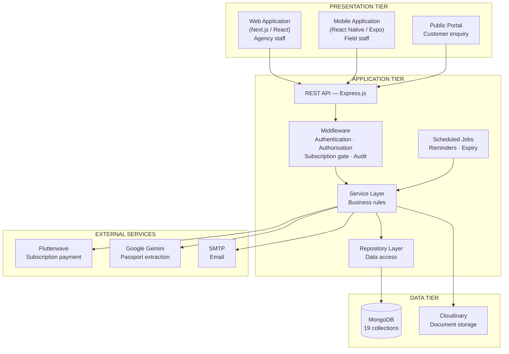
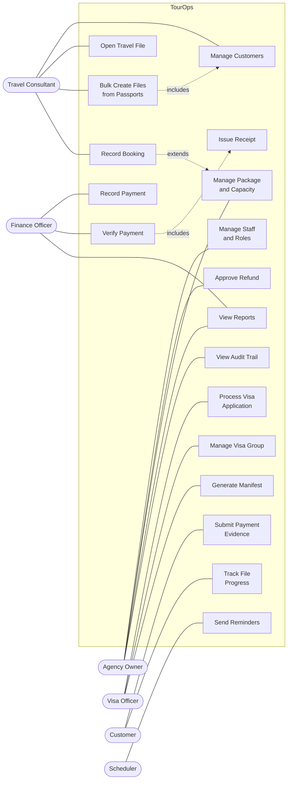
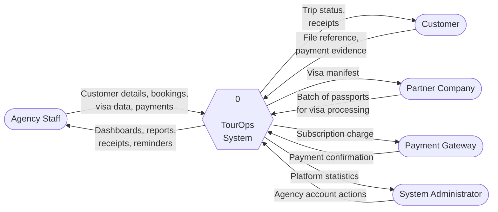
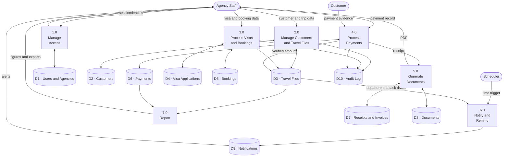
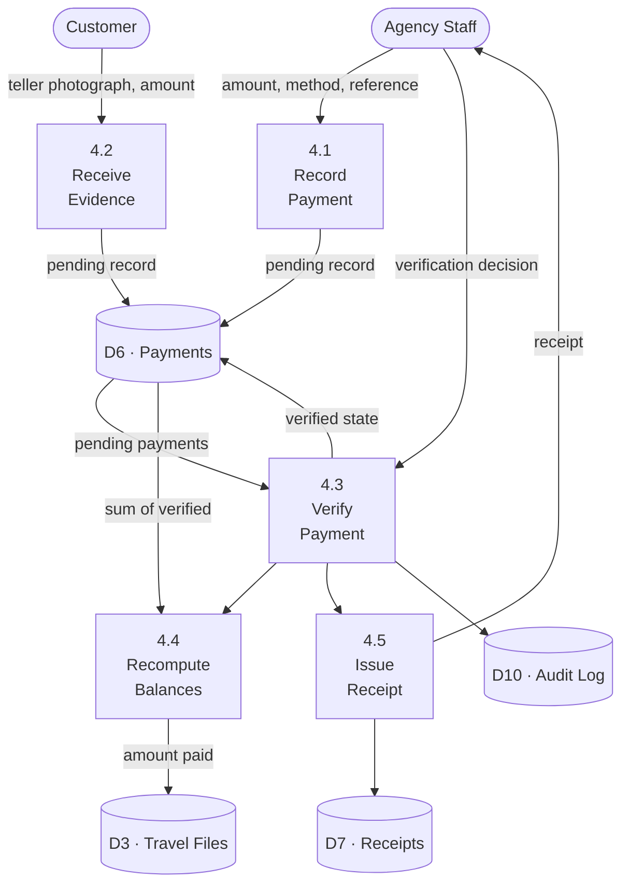

a# CHAPTER THREE
# SYSTEM ANALYSIS AND DESIGN

---

## 3.1 Introduction

Chapter Two established that micro and small travel agencies operating in Kano rely on fragmented tools — paper notebooks, WhatsApp threads and ad-hoc spreadsheets — and that existing commercial travel software is priced and structured for operators considerably larger than these businesses. This chapter sets out how the proposed system, TourOps, was analysed and designed to address that gap.

The chapter begins with the development methodology and the justification for its selection, then documents how requirements were elicited from the problem domain. It presents the functional and non-functional requirements, the system architecture, the use case model, the data flow diagrams and the entity-relationship model. Because the system handles passports, national identity documents and payment evidence, a dedicated section addresses document handling constraints and access control, as required during supervisory review of Chapter Two.

The design presented here was developed iteratively alongside a working prototype rather than specified entirely in advance. Where a design decision was revised during implementation, the revision and its reason are stated, since the reasoning is more instructive than a tidy account that conceals it.

---

## 3.2 Development Methodology

### 3.2.1 Choice of Methodology

An incremental and iterative methodology, following agile principles, was adopted for this project in preference to the traditional Waterfall model.

The decision rests on three characteristics of the problem domain. First, the requirements were not fully knowable at the outset. The operational practices of small agencies in Kano are informal and vary between businesses; several requirements — notably the handling of visa batches received from partner companies — only became apparent after an initial prototype was placed in front of an operator. Waterfall assumes requirements can be frozen after an analysis phase, which was not the case here.

Second, the project had a single developer and a short calendar. Incremental delivery allowed a usable subset of the system to exist early, which in turn allowed feedback on real behaviour rather than on paper specifications.

Third, the domain rewards correction. A misunderstanding about how an agency records a part-payment is cheap to fix in an iteration and expensive to discover after a full system has been built on the wrong assumption.

> **[CITATION REQUIRED]** Insert a genuine reference here justifying iterative/agile development over Waterfall for small-team projects with volatile requirements. Suitable sources include Sommerville's *Software Engineering* or Pressman's *Software Engineering: A Practitioner's Approach*. **Do not cite any source you have not read and verified.**

### 3.2.2 Development Increments

Development proceeded in increments, each producing working software:

| Increment | Scope | Outcome |
|---|---|---|
| 1 | Authentication, agency and user management, role-based access | Multiple staff could sign in with distinct privileges |
| 2 | Customer records and travel files | A trip could be recorded end to end |
| 3 | Bookings and the visa application pipeline | Visa progress became trackable |
| 4 | Payments, invoices and receipts | Money could be recorded and reconciled |
| 5 | Packages with capacity control, group bookings | Seat allocation could be enforced |
| 6 | Issued-visa batches and branded manifests | Partner-company work could be documented |
| 7 | Reporting, notifications, scheduled reminders | Oversight and prompting |
| 8 | Mobile client | Field access |

An important revision occurred between increments 4 and 5. The initial design recorded payments in two places — an array embedded in the invoice document and a second array embedded in the travel file. This duplication allowed the two records to disagree, and did in testing. The design was revised to a single `Payment` collection holding one record per transaction, with the balances shown on invoices and travel files derived from that collection rather than stored independently. This revision is discussed further in Section 3.9.4.

### 3.2.3 Requirements Elicitation

Three elicitation techniques were used.

**Direct observation.** Preliminary observation was conducted of the daily operations of micro-travel agencies in Kano, including the handling of pilgrim documentation during an Umrah season. Observation focused on where information was written down, who held it, and at what points it was lost or duplicated.

**Unstructured interviews.** Conversations were held with operators and with staff performing specific functions — a visa officer, a counter consultant — about the tasks they perform and the failures they encounter. These were unstructured rather than questionnaire-based because the objective was to discover unknown problems rather than to measure known ones.

**Document analysis.** Physical and electronic artefacts in current use were examined, including a visa manifest issued by one Kano agency on behalf of another. That document directly informed the design of the manifest generation feature described in Section 3.4.5: its column structure, its use of the issuing agency's letterhead, and the signature and stamp block it carries were all reproduced because partner companies already expect that format.

---

## 3.3 Analysis of the Existing System

The existing arrangement in the agencies studied is not a single system but a combination of practices:

- Customer particulars and trip details are written in exercise books or ledger sheets held at the counter.
- Passport copies and visa documents are photographed and stored in WhatsApp conversations, interleaved with unrelated messages.
- Payments are recorded in a separate cash book, frequently by a different member of staff from the one who booked the trip.
- Progress enquiries from customers are answered by telephone, requiring a staff member to locate the relevant record manually.
- Lists of issued visas for partner companies are typed into Microsoft Word for each batch.

### 3.3.1 Problems Identified

**P1 — Information is not consolidated.** No single location holds everything about one traveller. Answering "how much does this pilgrim still owe, and where is his visa?" requires consulting at least two sources and often a second person.

**P2 — Records are singly held and not concurrent.** A notebook can be used by one person at a time and exists in one place. When the staff member holding it is absent, the information is unavailable.

**P3 — No audit of who did what.** Where cash is recorded by hand, a discrepancy cannot be attributed to a particular person or moment.

**P4 — Document storage is unstructured.** A passport photographed into a WhatsApp thread is retrievable only by scrolling, and is lost when the device is lost or the conversation cleared.

**P5 — Capacity is not enforced.** Seat allocations for Hajj and Umrah packages are tracked mentally or on paper, permitting an agency to collect deposits from more pilgrims than it holds allocation for.

**P6 — No prompting.** Nothing reminds staff that a departure is approaching or that an instalment has fallen due; both depend on individual memory.

**P7 — Outputs are manually produced.** Each receipt and each partner manifest is typed afresh, consuming time and producing inconsistent documents.

These seven problems constitute the requirements baseline for the proposed system and are traced to specific requirements in Section 3.4.

---

## 3.4 Requirements Specification

### 3.4.1 Functional Requirements

Functional requirements are grouped by module. The rightmost column traces each requirement to the problem it addresses.

#### Authentication and Access Control

| ID | Requirement | Addresses |
|---|---|---|
| FR-01 | The system shall allow a travel agency to register an account, creating an agency record and an initial owner user. | P1 |
| FR-02 | The system shall authenticate users by email address and password, issuing a short-lived access token and a longer-lived refresh token. | P2 |
| FR-03 | The system shall allow an agency owner to invite staff members and assign each a role. | P2, P3 |
| FR-04 | The system shall restrict each user's operations according to the permissions granted to their role. | P3 |
| FR-05 | The system shall allow a user's session to be revoked, invalidating their refresh token. | P3 |

#### Customer and Travel File Management

| ID | Requirement | Addresses |
|---|---|---|
| FR-06 | The system shall allow staff to create, view, update and archive customer records containing personal particulars, contact details and passport information. | P1 |
| FR-07 | The system shall allow staff to search customers by name, telephone number or passport number. | P1 |
| FR-08 | The system shall allow staff to open a travel file for a customer, representing one trip, and shall assign each file a unique file number. | P1 |
| FR-09 | The system shall associate bookings, visa applications, uploaded documents, payments and invoices with a travel file. | P1 |
| FR-10 | The system shall maintain a chronological timeline of actions performed on each travel file. | P3 |
| FR-11 | The system shall allow staff to record tasks against a travel file, each with a due date, an assignee and a completion state. | P6 |
| FR-12 | The system shall extract traveller particulars from an uploaded file containing multiple passport data pages, present the extracted values for correction, and open one travel file per confirmed traveller. | P7 |

#### Bookings and Groups

| ID | Requirement | Addresses |
|---|---|---|
| FR-13 | The system shall allow staff to record bookings of type flight, ticket, visa, hotel, transport, tour, activity or package against a travel file. | P1 |
| FR-14 | The system shall allow staff to record a booking for a customer who has no travel file. | P1 |
| FR-15 | The system shall allow the status of a booking to be changed, and shall record each change. | P3 |
| FR-16 | The system shall allow several travellers to be grouped under one paying party while each retains individual documents and visa status. | P1 |

#### Visa Processing

| ID | Requirement | Addresses |
|---|---|---|
| FR-17 | The system shall allow a visa application to be created against a customer, recording destination, visa type, purpose of travel and fee. | P1 |
| FR-18 | The system shall track a visa application through the states: *draft, documents pending, documents submitted, appointment scheduled, under review, approved, rejected, cancelled*. | P1 |
| FR-19 | The system shall record and display whether the visa fee is unpaid, partially paid or fully paid. | P1 |
| FR-20 | The system shall allow an embassy appointment date, time and location to be recorded against an application. | P6 |
| FR-21 | The system shall allow a visa application to be assigned to a named visa officer. | P3 |

#### Issued Document Batches

| ID | Requirement | Addresses |
|---|---|---|
| FR-22 | The system shall allow the creation of a visa group representing a batch of work received from a partner company, identified by a system-generated group number. | P7 |
| FR-23 | The system shall allow entries to be added to a visa group incrementally over multiple days, each entry recording traveller name, passport number, document number, purpose and date of issue. | P7 |
| FR-24 | The system shall allow a scanned copy of each issued document to be attached to its entry. | P4 |
| FR-25 | The system shall generate a printable manifest of a visa group, or of a selected subset of its entries, bearing the agency's name, logo and registration details. | P7 |
| FR-26 | The system shall allow issued documents to be recorded outside any group, for one-off issuances. | P7 |

#### Financial Management

| ID | Requirement | Addresses |
|---|---|---|
| FR-27 | The system shall record each payment as a single transaction associated with a travel file, invoice, visa application or booking. | P1, P3 |
| FR-28 | The system shall hold a payment in a *pending* state until verified, and shall exclude unverified payments from recorded balances. | P3 |
| FR-29 | The system shall allow a customer to submit evidence of payment for verification by staff. | P1 |
| FR-30 | The system shall generate a receipt automatically when a payment is verified, and shall not generate more than one receipt for the same payment. | P7 |
| FR-31 | The system shall generate invoices and produce them as printable documents. | P7 |
| FR-32 | The system shall support a refund workflow in which a refund is requested by one user and approved by another. | P3 |
| FR-33 | The system shall allow a payment schedule of instalments to be defined against a travel file. | P6 |

#### Packages and Capacity

| ID | Requirement | Addresses |
|---|---|---|
| FR-34 | The system shall allow tour packages to be defined with pricing, itinerary and a maximum capacity. | P5 |
| FR-35 | The system shall refuse to confirm a booking against a package whose capacity is already fully allocated. | P5 |
| FR-36 | The system shall display, for each package, the number of seats sold, held and remaining. | P5 |

#### Documents

| ID | Requirement | Addresses |
|---|---|---|
| FR-37 | The system shall allow documents to be uploaded and categorised as passport, visa, ticket, hotel, insurance, financial, photo or other. | P4 |
| FR-38 | The system shall track each document through the states: *required, missing, submitted, under review, approved, rejected, expired, not applicable*. | P4 |
| FR-39 | The system shall record a document's expiry date and mark it expired when that date passes. | P6 |

#### Notification and Reminders

| ID | Requirement | Addresses |
|---|---|---|
| FR-40 | The system shall notify agency staff five days and again three days before a recorded departure date. | P6 |
| FR-41 | The system shall notify staff of tasks falling due within three days and of tasks already overdue. | P6 |
| FR-42 | The system shall notify staff of instalments falling due and of instalments already overdue. | P6 |
| FR-43 | The system shall not issue the same reminder more than once for the same event. | P6 |

#### Reporting and Enquiry

| ID | Requirement | Addresses |
|---|---|---|
| FR-44 | The system shall present aggregate figures for customers, active bookings, pending visa applications, revenue received and amounts outstanding. | P1 |
| FR-45 | The system shall allow records to be filtered by calendar month, calendar year, an explicit date range, or a named period. | P1 |
| FR-46 | The system shall export invoice and booking records in comma-separated value format. | P1 |
| FR-47 | The system shall allow a customer to check the progress of their own travel file using a file reference, without authenticating. | P1 |
| FR-48 | The system shall record every change made through the application together with the user responsible, and shall present that record to the agency owner. | P3 |

### 3.4.2 Non-Functional Requirements

| ID | Category | Requirement |
|---|---|---|
| NFR-01 | Performance | A list view shall return within two seconds over a 3G mobile connection for a dataset of up to 10,000 records per agency. |
| NFR-02 | Performance | List endpoints shall paginate, returning at most 100 records per request. |
| NFR-03 | Scalability | The data model shall support multiple agencies within one deployment without data from one agency being reachable by another. |
| NFR-04 | Security | Passwords shall be stored only as salted hashes, never in recoverable form. |
| NFR-05 | Security | Access tokens shall expire within fifteen minutes; refresh tokens shall be revocable. |
| NFR-06 | Security | Every request shall derive the agency context from the authenticated session and never from client-supplied input. |
| NFR-07 | Security | File uploads shall be constrained by type and size as specified in Section 3.10.3. |
| NFR-08 | Availability | The system shall be reachable over the public internet and shall not require installation on a client machine. |
| NFR-09 | Usability | Staff with basic smartphone literacy shall be able to complete the core tasks after a single demonstration. |
| NFR-10 | Usability | The interface shall be operable on a mobile screen of 360 CSS pixels width without horizontal scrolling. |
| NFR-11 | Reliability | Generation of a receipt shall be idempotent; a repeated or concurrent request shall not produce a duplicate. |
| NFR-12 | Reliability | Failure of a secondary action, such as issuing a receipt or sending a notification, shall not invalidate the primary transaction. |
| NFR-13 | Maintainability | Business logic shall reside in a service layer, separate from HTTP handling and from data access. |
| NFR-14 | Auditability | All state-changing operations shall be recorded with actor, action, resource and timestamp. |
| NFR-15 | Localisation | Monetary values shall be presented in Nigerian Naira; dates shall follow the day/month/year convention. |

### 3.4.3 Feasibility Considerations

**Technical.** The required capabilities — authenticated multi-user access, document storage, PDF generation, scheduled background work — are all served by mature, freely available components. No capability in the specification required bespoke infrastructure.

**Economic.** Development used open-source frameworks and free service tiers. The recurring cost to operate a deployment is limited to hosting, a managed database and a media storage account, all of which have usage-based tiers appropriate to the expected volume of a small agency.

**Operational.** This is the weakest axis and should be stated honestly. The target users are accustomed to paper and WhatsApp, and adoption depends on the system being faster than the practice it replaces for the tasks performed most often. This constraint drove several design decisions, including the bulk passport intake of FR-12 and the camera-first document capture on the mobile client.

---

## 3.5 System Architecture

### 3.5.1 Architectural Style

The system follows a three-tier client-server architecture with a clear separation between presentation, application logic and data storage. The presentation tier comprises two independent clients — a web application and a mobile application — which share one application tier through a versioned HTTP API. No business logic is duplicated between clients; both call the same endpoints.

This separation was deliberate. A single shared application tier means a rule such as "a payment does not count until verified" exists in exactly one place, and cannot be enforced on the web while being absent on mobile.



**Figure 3.1 — System architecture**

### 3.5.2 Layer Responsibilities

**Controller layer.** Translates between HTTP and the service layer. Reads parameters, calls one service method, formats the response. Controllers contain no business rules.

**Middleware layer.** Cross-cutting concerns applied before a request reaches a controller: verifying the access token, checking that the user's role carries the required permission, confirming the agency's subscription permits the operation, and recording the action for audit.

**Service layer.** Holds the business rules. This is where the decision that a payment must be verified before it counts, or that a seat cannot be sold beyond capacity, is made and enforced.

**Repository layer.** Encapsulates database queries behind named methods, so a change to a query shape does not propagate into business logic.

### 3.5.3 Technology Stack and Justification

| Layer | Technology | Justification |
|---|---|---|
| Web client | Next.js (React) | Server-side rendering improves first-load time on constrained connections; one language across the whole stack reduces context switching for a single developer |
| Mobile client | React Native with Expo | Produces Android and iOS clients from one codebase; Android dominates the target market, and Expo removes the need for a Mac to develop |
| API | Node.js with Express and TypeScript | Static typing catches a class of defect at compile time; the same TypeScript interfaces describe data on both server and client |
| Database | MongoDB | A travel file aggregates heterogeneous and optional sub-structures — timeline entries, tasks, notes, payment schedules — which a document model represents without a proliferation of join tables |
| Document storage | Cloudinary | Binary files are kept out of the database; delivery is via CDN, which matters where bandwidth is limited |
| Payment gateway | Flutterwave | Supports card, bank transfer and USSD, which are the instruments actually used in Nigeria |
| Document extraction | Google Gemini | Multimodal reading of passport pages and multi-page PDFs without a separate OCR pipeline |

A note on the database choice, since it is the decision most open to challenge in a project of this kind. The data is relational in character — customers have travel files, which have bookings — and a relational database would model those relationships with integrity constraints the application must otherwise enforce itself. MongoDB was selected because the dominant aggregate, the travel file, carries several optional nested collections that vary in size and shape between records, and because referential integrity in this system is enforced at the service layer regardless. This is a trade-off, not a free choice, and Section 3.9.5 states the integrity obligations it transfers to the application.

---

## 3.6 Use Case Modelling

### 3.6.1 Actors

| Actor | Description |
|---|---|
| **Agency Owner** | Proprietor of the agency. Full access, including staff management, financial oversight, refund approval and the audit trail. |
| **Travel Consultant** | Counter staff. Creates customers, opens travel files, records bookings. |
| **Visa Officer** | Handles the visa pipeline and the documents supporting it. |
| **Finance Officer** | Records and verifies payments, raises refund requests, reads reports. Cannot approve a refund. |
| **Customer Support** | Read access across modules for answering enquiries. |
| **Customer** | The traveller. Views own records through the portal, uploads payment evidence, checks progress by file reference. |
| **System Administrator** | Platform operator. Manages agency accounts and subscriptions across the deployment. |
| **Scheduler** *(secondary)* | Non-human actor. Triggers time-based reminders and expiry marking. |
| **Payment Gateway** *(secondary)* | Non-human actor. Confirms subscription payments. |

### 3.6.2 Use Case Diagram



**Figure 3.2 — Use case diagram**

### 3.6.3 Expanded Use Case Descriptions

Three use cases are expanded below. They were selected because each carries a non-obvious business rule.

---

**UC-10: Verify Payment**

| Field | Detail |
|---|---|
| **Use case ID** | UC-10 |
| **Actor** | Finance Officer (primary); Agency Owner |
| **Description** | A member of staff confirms that money claimed to have been received has in fact been received, after which it counts towards balances. |
| **Preconditions** | A payment record exists in the *pending* state. The actor holds the `payments:write` permission. The agency subscription permits write operations. |
| **Postconditions** | The payment is in the *verified* state. All cached balances on the associated travel file, invoice, visa application or booking have been recomputed. A receipt exists for the payment. |

*Main flow*

1. The actor opens the payment verification queue.
2. The system displays pending payments with amount, method, date, the staff member who recorded it, and any attached evidence.
3. The actor selects a payment and inspects the evidence against the agency's bank record.
4. The actor confirms verification.
5. The system sets the payment state to *verified* and records the verifying user and the time.
6. The system recomputes the amount paid on every related record from the sum of verified payments.
7. The system generates a receipt for the payment.
8. The system appends an entry to the travel file timeline.
9. The system confirms the action to the actor.

*Alternative flow A1 — payment rejected*

At step 4 the actor rejects the payment and supplies a reason. The system sets the state to *rejected*, stores the reason, and leaves balances unchanged. No receipt is produced.

*Alternative flow A2 — already verified*

At step 4, if the payment is already verified, the system refuses the operation and reports that it has already been verified.

*Business rules*

- **BR-1** A payment in any state other than *verified* contributes nothing to any balance.
- **BR-2** Balances are derived by summing verified payments, never by incrementing a stored total. This prevents divergence between the ledger and the balance.
- **BR-3** Receipt generation is idempotent. A payment may hold at most one receipt, enforced by a uniqueness constraint on the payment reference within the receipt collection.
- **BR-4** Failure to generate a receipt does not reverse the verification. The money has been received; the document is secondary.

---

**UC-04: Bulk Create Travel Files from Passports**

| Field | Detail |
|---|---|
| **Use case ID** | UC-04 |
| **Actor** | Travel Consultant |
| **Description** | Opens a travel file for each traveller in a group by reading their passport data pages from a single uploaded file. |
| **Preconditions** | The actor is authenticated and holds `bookings:write`. A file containing one or more passport data pages is available. |
| **Postconditions** | A customer record exists for each confirmed traveller; a travel file exists for each. |

*Main flow*

1. The actor selects bulk creation and uploads a file (PDF or image).
2. The system validates the file against the type and size constraints of Section 3.10.3.
3. The system submits the file for extraction and receives a set of candidate traveller records.
4. The system displays the candidates in an editable table, marking rows of low extraction confidence and rows missing mandatory values.
5. The actor corrects any incorrect values and removes any spurious rows.
6. The actor supplies the trip details common to all travellers: travel type, destination, departure group, dates and cost.
7. The actor confirms.
8. For each traveller, the system searches for an existing customer with the same passport number; where none exists, it creates one.
9. The system opens a travel file for each traveller.
10. The system reports the number created and lists any that failed, with reasons.

*Alternative flow A1 — no passport found*

At step 3, if no passport can be read, the system informs the actor and no records are created.

*Alternative flow A2 — partial failure*

At step 9, if an individual traveller cannot be processed, that traveller is reported as failed and processing continues with the remainder.

*Business rules*

- **BR-5** Extracted values are treated as provisional. No record is written until a human has reviewed them. Automatic extraction informs the operator; it does not replace them.
- **BR-6** Customers are matched on passport number, not name, since names are transliterated inconsistently.
- **BR-7** A failure affecting one traveller shall not abort the batch.

---

**UC-08: Generate Visa Manifest**

| Field | Detail |
|---|---|
| **Use case ID** | UC-08 |
| **Actor** | Visa Officer |
| **Description** | Produces a printable list of issued visas for return to the partner company that commissioned them. |
| **Preconditions** | A visa group exists and holds at least one entry. |
| **Postconditions** | A PDF document is produced. No system state changes. |

*Main flow*

1. The actor opens a visa group.
2. The actor optionally selects a subset of entries.
3. The actor requests the manifest.
4. The system retrieves the agency's name, logo and registration number.
5. The system composes a document containing a letterhead, the group number and name, the partner company, and a table of passport number, traveller name, document number, purpose and issue date.
6. The system appends a traveller total and a signature and stamp block.
7. The system returns the document for download.

*Business rules*

- **BR-8** The manifest bears the issuing agency's identity, as the partner company requires attributable documentation.
- **BR-9** Where a subset is selected, only those entries appear; the total reflects the subset.
- **BR-10** The document is generated on demand and never stored, so it always reflects current data.

---

## 3.7 Data Flow Diagrams

### 3.7.1 Context Diagram (Level 0)



**Figure 3.3 — Context diagram**

### 3.7.2 Level 1 Data Flow Diagram



**Figure 3.4 — Level 1 data flow diagram**

### 3.7.3 Level 2 — Decomposition of Process 4.0 (Process Payments)



**Figure 3.5 — Level 2 DFD for payment processing**

---

## 3.8 Database Design

### 3.8.1 Approach

The system uses MongoDB, a document-oriented database. The design therefore distinguishes between data that is *embedded* within a parent document and data that is *referenced* from a separate collection. The governing rule applied throughout was:

- Data that is only ever read in the context of its parent, is bounded in size, and is not queried independently, is **embedded**. The timeline, tasks and notes of a travel file are examples.
- Data that is queried independently, grows without bound, or is shared between parents, is **referenced** in its own collection. Payments, documents and bookings are examples.

The system comprises **nineteen collections**.

### 3.8.2 Entity-Relationship Diagram

```mermaid
erDiagram
    AGENCY ||--o{ USER : employs
    AGENCY ||--o{ CUSTOMER : owns
    AGENCY ||--o{ TRAVEL_FILE : owns
    AGENCY ||--o{ BRANCH : operates
    AGENCY ||--o{ TOUR_PACKAGE : offers
    AGENCY ||--o{ VISA_GROUP : manages
    AGENCY ||--o{ SUBSCRIPTION_PAYMENT : pays

    CUSTOMER ||--o{ TRAVEL_FILE : "is subject of"
    CUSTOMER ||--o{ VISA_APPLICATION : applies
    CUSTOMER ||--o{ BOOKING : holds
    CUSTOMER ||--o{ DOCUMENT : provides
    CUSTOMER ||--o{ PAYMENT : makes

    TRAVEL_FILE ||--o{ BOOKING : contains
    TRAVEL_FILE ||--o| VISA_APPLICATION : "may contain"
    TRAVEL_FILE ||--o{ PAYMENT : receives
    TRAVEL_FILE ||--o{ DOCUMENT : holds
    TRAVEL_FILE ||--o{ INVOICE : "is billed by"
    BOOKING_GROUP ||--o{ TRAVEL_FILE : groups

    TOUR_PACKAGE ||--o{ BOOKING : "is booked as"

    INVOICE ||--o{ PAYMENT : "is settled by"
    PAYMENT ||--o| RECEIPT : "produces"
    PAYMENT ||--o{ REFUND : "may be reversed by"

    VISA_GROUP ||--o{ VISA_ISSUANCE : contains

    USER ||--o{ AUDIT_LOG : generates
    USER ||--o{ NOTIFICATION : receives
    USER ||--o{ PAYMENT : records

    AGENCY {
        ObjectId _id PK
        string name
        string email
        string phone
        string rcNumber
        object bankDetails
        object subscription
        object branding
        boolean isActive
    }

    USER {
        ObjectId _id PK
        ObjectId agencyId FK
        string firstName
        string lastName
        string email UK
        string password "hashed"
        enum role
        array refreshTokens
        boolean isActive
    }

    CUSTOMER {
        ObjectId _id PK
        ObjectId agencyId FK
        string firstName
        string lastName
        string email "optional"
        string phone "optional"
        date dateOfBirth
        object passport
        enum status
    }

    TRAVEL_FILE {
        ObjectId _id PK
        ObjectId agencyId FK
        ObjectId customerId FK
        ObjectId groupId FK
        string fileNumber UK
        enum travelType
        string destination
        date departureDate
        enum status
        number totalCost
        number amountPaid "derived"
        array paymentSchedule
        array timeline
        array tasks
        array notes
    }

    BOOKING {
        ObjectId _id PK
        ObjectId agencyId FK
        ObjectId customerId FK
        ObjectId travelFileId FK
        string bookingNumber UK
        enum bookingType
        enum status
        number cost
        number amountPaid "derived"
        date startDate
    }

    VISA_APPLICATION {
        ObjectId _id PK
        ObjectId agencyId FK
        ObjectId customerId FK
        ObjectId assignedOfficer FK
        string referenceNumber UK
        string visaNumber
        string destinationCountry
        enum status
        number fees
        number amountPaid "derived"
        object appointment
    }

    PAYMENT {
        ObjectId _id PK
        ObjectId agencyId FK
        ObjectId customerId FK
        ObjectId travelFileId FK
        ObjectId invoiceId FK
        number amount
        enum method
        enum status
        string proofUrl
        ObjectId recordedBy FK
        ObjectId verifiedBy FK
        date paidAt
    }

    RECEIPT {
        ObjectId _id PK
        ObjectId agencyId FK
        ObjectId customerId FK
        ObjectId paymentId FK_UK
        string receiptNumber UK
        number amount
        enum method
        date paidAt
    }

    VISA_GROUP {
        ObjectId _id PK
        ObjectId agencyId FK
        string groupNumber UK
        string name
        string partnerCompany
        date travelDate
        enum status
    }

    VISA_ISSUANCE {
        ObjectId _id PK
        ObjectId agencyId FK
        ObjectId groupId FK
        enum type
        string travellerName
        string passportNumber
        string documentNumber
        date issueDate
        string fileUrl
    }

    DOCUMENT {
        ObjectId _id PK
        ObjectId agencyId FK
        ObjectId customerId FK
        enum category
        enum status
        string fileUrl
        date expiryDate
    }

    TOUR_PACKAGE {
        ObjectId _id PK
        ObjectId agencyId FK
        string title
        object pricing
        object availability
        enum status
    }

    AUDIT_LOG {
        ObjectId _id PK
        ObjectId agencyId FK
        ObjectId userId FK
        string action
        string resource
        ObjectId resourceId
        string ipAddress
        date createdAt
    }
```

**Figure 3.6 — Entity-relationship diagram**

*For legibility the diagram omits Invoice, Refund, Branch, Booking Group, Notification and Subscription Payment attribute lists; their relationships are shown.*

### 3.8.3 Collection Summary

| # | Collection | Purpose |
|---|---|---|
| 1 | `agencies` | Tenant record: identity, bank details, branding, subscription |
| 2 | `users` | Staff accounts, roles, refresh tokens |
| 3 | `customers` | Travellers and their passport particulars |
| 4 | `travelfiles` | One trip; the central aggregate |
| 5 | `bookings` | Individual arrangements within or outside a file |
| 6 | `bookinggroups` | Families or departure batches under one payer |
| 7 | `visaapplications` | Visa pipeline |
| 8 | `visagroups` | Batches of issued visas for partner companies |
| 9 | `visaissuances` | Individual issued visa or ticket records |
| 10 | `documents` | Uploaded file metadata and review state |
| 11 | `payments` | Single source of truth for money received |
| 12 | `receipts` | Acknowledgement of verified payment |
| 13 | `invoices` | Amounts billed |
| 14 | `refunds` | Reversal requests and approvals |
| 15 | `tourpackages` | Package definitions and capacity |
| 16 | `branches` | Physical offices |
| 17 | `notifications` | In-application alerts |
| 18 | `auditlogs` | Record of every state change |
| 19 | `subscriptionpayments` | Payments from agencies to the platform |

### 3.8.4 Design Decision: Single Payment Collection

As noted in Section 3.2.2, the initial design embedded payment arrays in both the invoice and the travel file. Two copies of the same transaction could, and did, diverge.

The revised design holds one `Payment` document per transaction. The `amountPaid` fields visible on travel files, invoices, visa applications and bookings are **derived values**, recomputed from the sum of verified payments whenever a payment changes state. They exist to avoid an aggregation on every list query, not as an independent record of truth. If a cached value were ever to disagree with the payment collection, the collection is correct and the cache is recomputed.

This yields three properties worth stating: a transaction is recorded once; a balance cannot silently diverge from its ledger; and money is traceable to the user who recorded it and the user who verified it.

### 3.8.5 Integrity Obligations

Because MongoDB does not enforce foreign keys, the following constraints are enforced by the application and are listed here so they are not assumed to be automatic:

1. Every query is scoped by `agencyId`, derived from the session, so one tenant cannot read another's data.
2. Parent existence is verified before a child record is written.
3. Uniqueness is enforced by database indexes where a duplicate would be harmful: file numbers, booking numbers, receipt numbers, group numbers, and one receipt per payment.
4. Deletion of a parent holding dependent records is refused rather than cascaded.

### 3.8.6 Indexing

Compound indexes lead with `agencyId`, since no query crosses tenants. Examples include `{agencyId, status}` on travel files, `{agencyId, createdAt}` on audit logs, and `{agencyId, groupNumber}` as a unique index on visa groups. The customer email index is **partial**, applying uniqueness only to records that actually hold an email address — necessary because pilgrims booked by one payer frequently have none.

---

## 3.9 Security Design

This section responds to the supervisory requirement that document handling and access control be specified, given that the system stores passports, national identity documents and payment evidence.

### 3.9.1 Authentication

Users authenticate with an email address and a password. Passwords are hashed with bcrypt at a cost factor of 12, with a per-password salt generated automatically; the plaintext is never stored and cannot be recovered. The cost factor is deliberately high enough that brute-forcing a recovered hash is impractical, while remaining fast enough not to delay a legitimate sign-in noticeably.

On successful authentication the system issues two tokens: an **access token** valid for fifteen minutes, presented with each request, and a **refresh token** valid for seven days, used to obtain a new access token. Refresh tokens are stored against the user record, which allows a specific session to be revoked — for example when a staff member leaves. A refresh token not present in the user's stored list is rejected even if its signature is valid.

The short access-token lifetime limits the window during which an intercepted token is useful.

### 3.9.2 Authorisation

Authorisation is role-based. Seven roles are defined, and twenty-eight discrete permissions are allocated among them. Permission is checked at the route level before a controller executes.

| Permission group | Owner | Consultant | Visa Officer | Finance Officer | Support | Customer |
|---|:--:|:--:|:--:|:--:|:--:|:--:|
| Customers — read | ✓ | ✓ | ✓ | ✓ | ✓ | — |
| Customers — write | ✓ | ✓ | — | — | ✓ | — |
| Customers — delete | ✓ | — | — | — | — | — |
| Visas — read | ✓ | ✓ | ✓ | — | ✓ | ✓ |
| Visas — write | ✓ | — | ✓ | — | — | — |
| Bookings — read | ✓ | ✓ | — | ✓ | ✓ | ✓ |
| Bookings — write | ✓ | ✓ | — | — | — | — |
| Documents — read | ✓ | ✓ | ✓ | — | ✓ | ✓ |
| Documents — write | ✓ | ✓ | ✓ | — | — | ✓ |
| Payments — read | ✓ | — | — | ✓ | — | ✓ |
| Payments — write | ✓ | — | — | ✓ | — | — |
| Refunds — write (request) | ✓ | — | — | ✓ | — | — |
| Refunds — approve | ✓ | — | — | **—** | — | — |
| Reports — read | ✓ | — | — | ✓ | — | — |
| Users — manage | ✓ | — | — | — | — | — |
| Settings — write | ✓ | — | — | — | — | — |

**Table 3.1 — Role and permission matrix**

Two aspects deserve comment.

**Separation of duties on refunds.** The finance officer may *request* a refund but may not *approve* one; approval rests with the owner. A single individual therefore cannot both initiate and release a payment out of the business. This is the one place in the design where a deliberate inconvenience was accepted in exchange for a control.

**Least privilege by default.** The visa officer, who handles the most sensitive documents, holds no permission over payments, reports, users or settings. A compromised visa officer account exposes visa and document data only.

### 3.9.3 Document Upload Controls

All uploads pass through a single shared upload component. There is deliberately one place in the codebase where these constraints are defined, so no endpoint can accept a file under weaker rules.

**Permitted formats.** Four MIME types are accepted and all others rejected:

| Format | MIME type | Typical use |
|---|---|---|
| JPEG | `image/jpeg` | Photographs of passports and visas |
| PNG | `image/png` | Screenshots, scanned pages |
| WebP | `image/webp` | Compressed images from mobile devices |
| PDF | `application/pdf` | Multi-page scans, tickets, bank tellers |

Executable, archive and office-document formats are rejected, removing a common vector by which a malicious file is uploaded and later executed or opened.

**Size limit.** Ten megabytes per file. The limit is enforced by the server, not by the browser, and a file exceeding it is rejected before it is written anywhere.

**Validation point.** Files are held in memory during validation and are streamed to storage only after passing it. No unvalidated file is written to the server's filesystem, and no upload endpoint writes to the application's own disk at all.

**Storage.** Validated files are stored on Cloudinary under segregated folders — `tourops/documents` for customer documents and `tourops/issued-documents` for issued visas and tickets. Binary content is therefore never held in the application database, and the application server retains no copy.

**Access.** Document metadata — category, status, expiry, owning customer — is held in the database and is subject to the same tenant scoping and role checks as every other record. A user without `documents:read` cannot enumerate documents, and a user of one agency cannot retrieve another agency's document records.

> **Limitation to disclose.** Stored file URLs are presently unsigned. A party who obtains a URL could retrieve that file without authenticating. The metadata is protected, but the binary is not. For a production deployment holding passport images this should be replaced with time-limited signed URLs, so that a link expires shortly after issue. This is stated here rather than omitted because an honest account of a known weakness is of more use than a claim of completeness.

### 3.9.4 Multi-Tenancy Isolation

The deployment serves several agencies from one database. Isolation rests on a single invariant: **the agency identifier is always taken from the authenticated session and never from client input.** A request cannot ask for another agency's data by supplying a different identifier, because the identifier in the request body is not consulted. Every repository query is scoped by it.

### 3.9.5 Transport and Application Hardening

| Control | Implementation |
|---|---|
| Transport encryption | HTTPS enforced in deployment; tokens never transmitted in clear |
| Security headers | Helmet middleware sets standard protective response headers |
| Injection resistance | Query operator stripping on request payloads, preventing NoSQL operator injection |
| Rate limiting | 2,000 requests per fifteen minutes per IP address across the API; 30 per fifteen minutes on the unauthenticated public tracking endpoint, which would otherwise permit file numbers to be guessed at speed |
| Cross-origin policy | Restricted to the configured client origin |
| Audit | Every state-changing request is recorded with actor, action, resource, address and timestamp |
| Secret management | Credentials supplied through environment variables, excluded from version control |

### 3.9.6 Audit Logging

Every mutating request that completes successfully is recorded with the acting user, the action, the resource affected, the originating address and the timestamp. The log is readable by the agency owner and is not editable through the application.

This addresses problem **P3**. Where a discrepancy arises in a paper cash book, nothing identifies who made an entry. Here, every change is attributable.

---

## 3.10 Interface Design

### 3.10.1 Principles

Four principles governed the interface, each derived from an observed characteristic of the users.

**One accent colour.** The interface uses a single accent throughout. Earlier iterations allowed each agency to set its own colour; this was removed after it was found to conflict with the semantic use of colour — green for settled, red for outstanding, amber for pending — which must mean the same thing on every screen.

**Mobile-first layout.** Staff frequently work from a telephone. Every screen is laid out for a narrow viewport first and expands to a desktop width, rather than the reverse.

**Money shown first.** On screens where a financial position exists, it appears before operational detail, because that is what is most often being sought.

**Progressive disclosure.** The primary navigation presents grouped sections rather than a flat list of every module, and secondary functions are reached through tabs within a section. This followed from an observation during demonstration: a long list of modules caused operators to describe the system as complicated before using it.

### 3.10.2 Navigation Structure

```
Dashboard
Operations ── Travel Files · Bookings · Visas · Customers · Documents
Finance ───── Payments · Invoices · Receipts · Reports
Agency ────── Packages · Insights · Team · Audit Trail · Billing · Settings
```

Related functions were consolidated behind tabs rather than given separate navigation entries: visa applications, issued visa groups and individually issued documents share one Visas section; individual bookings and family groups share one Bookings section.

### 3.10.3 Output Design

Three printable documents are generated server-side as PDF, each carrying the agency's letterhead, logo and registration number: the **invoice**, the **receipt**, and the **visa manifest**. The manifest layout was modelled on a document in current use between Kano agencies, so that it meets the expectations of the partner companies that receive it.

---

## 3.11 Summary

This chapter has presented the analysis and design of TourOps. An incremental methodology was adopted and justified by the volatility of the requirements and the single-developer constraint. Seven problems were identified in current practice and traced to forty-eight functional and fifteen non-functional requirements.

A three-tier architecture was specified in which two client applications share one application tier, so that business rules exist in a single place. The use case model identified nine actors, and three use cases carrying non-obvious business rules were expanded. Data flows were documented at context, first and second levels. A nineteen-collection data model was presented, together with the embedding rules that produced it and the integrity obligations it transfers to the application layer.

The security design specifies bcrypt password hashing, short-lived access tokens with revocable refresh tokens, a seven-role and twenty-eight-permission authorisation matrix with separation of duties on refunds, and document upload controls restricting uploads to four formats and ten megabytes. One known weakness — unsigned storage URLs — has been disclosed rather than omitted.

Chapter Four presents the implementation of this design, the technologies applied, and the testing conducted against the requirements specified here.

---

---

# NOTES FOR THE AUTHOR — REMOVE BEFORE SUBMISSION

### 1. Citations

**No references have been invented anywhere in this document.** Your supervisor specifically warned you to ensure cited literature is genuine. There is one marked `[CITATION REQUIRED]` in Section 3.2.1. Your department will likely expect citations in these places as well:

- **3.2.1** — justification of iterative/agile over Waterfall
- **3.5.1** — three-tier architecture as an established style
- **3.6** — use case modelling and UML notation
- **3.7** — data flow diagram notation (Gane & Sarson, or DeMarco & Yourdon — state which you follow)
- **3.8.1** — document-oriented versus relational data modelling
- **3.9.1** — bcrypt, or password storage guidance such as the OWASP Authentication Cheat Sheet
- **3.9.2** — role-based access control

Find these yourself, read them, and cite them in your department's required style. Do not take a reference from any AI tool without opening it and confirming it exists.

### 2. Your supervisor's first correction — Section 1.2

He asked you to remove the first person from Chapter 1. Here is a rewrite you can adapt:

> *Original:* "I run a small travel agency myself…"
>
> *Revised:* "Preliminary observation was conducted of micro-travel agencies operating in Kano metropolis, including sustained access to the daily operations of one such agency over the course of an Umrah season. This access permitted direct observation of record-keeping practice rather than reliance on reported behaviour, and the problems set out in this section derive from that observation."

This keeps the strength of your real access — which is genuinely the best thing about your problem statement — while removing the first person. Throughout Chapter 3 I have used "the system shall" and "observation was conducted", never "I".

### 3. Rendering the diagrams

The four diagrams are written in Mermaid. To produce images for Word:

1. Go to **mermaid.live**
2. Paste one diagram's code (everything between the ```` ```mermaid ```` markers)
3. Export as PNG or SVG
4. Insert into your Word document and caption it as numbered here

If your department requires a specific notation for DFDs (Gane & Sarson circles versus Yourdon bubbles), redraw them in draw.io instead and say which notation you followed.

### 4. On not looking AI-generated

The strongest defence is that this document is specific to your actual system. The numbers are real and verifiable in your code: 19 collections, 7 roles, 28 permissions, 4 permitted MIME types, 10 MB, 15-minute access tokens, 2,000 requests per 15 minutes. An examiner can open your repository and check any of them.

Three further things help, and only you can do them:

- **Keep the admissions.** The payment-duplication revision in 3.2.2 and 3.8.4, the database trade-off in 3.5.3, the unsigned-URL weakness in 3.9.3, and the operational feasibility concern in 3.4.3. Generated text almost never concedes a weakness. A defence where you can explain a mistake you made and fixed is far more convincing than one with no mistakes in it.
- **Add your own observations.** Anywhere you can insert something only you witnessed — a specific incident at the agency, something an operator said — do so. That is unforgeable.
- **Read it aloud before you submit.** Change any sentence you would not say. If a phrase is not yours, replace it with one that is. You must be able to defend every line in a viva.

### 5. What I could not verify

- The performance figures in NFR-01 and NFR-02 are design targets, not measured results. Either measure them for Chapter 4 or label them explicitly as targets.
- The claim in 3.4.3 that operators adopt the system readily is an expectation, not a finding. If you have not yet tested it with real staff, do not state it as fact.
